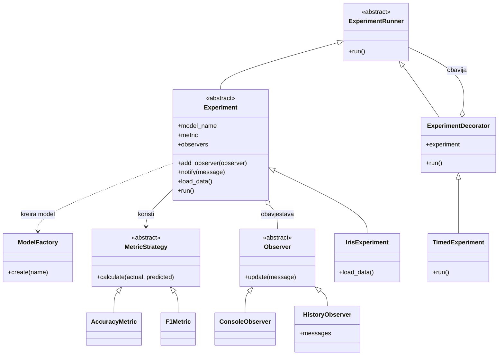

# Mini projekat 2: Mini okvir za ML eksperimente

**Student:** Andrija Gojković  
**Broj indeksa:** FIST 26/016  
**Predmet:** Napredno programiranje

## Opis projekta

Projekat predstavlja jednostavan okvir za izvođenje eksperimenata mašinskog učenja. Demonstrira primjenu pet obrazaca dizajna: Factory, Strategy, Observer, Template Method i Decorator.

Za demonstraciju se koristi Iris skup podataka i tri klasifikaciona modela:

- Logistička regresija
- Stablo odlučivanja
- k najbližih susjeda (kNN)

Za svaki model izračunavaju se accuracy i macro F1. Program prikazuje događaje tokom eksperimenta i mjeri ukupno vrijeme izvršavanja.

## Pokretanje

Preporučuje se Python 3.12. Komande se izvršavaju iz foldera `mini_projekat_2`.

Kreiranje virtuelnog okruženja:

```bash
python -m venv .venv
```

Aktivacija u Windows PowerShell terminalu:

```powershell
.\.venv\Scripts\Activate.ps1
```

Aktivacija na Linuxu ili macOS-u:

```bash
source .venv/bin/activate
```

Instalacija zavisnosti:

```bash
python -m pip install -r requirements.txt
```

Pokretanje programa:

```bash
python main.py
```

Pokretanje testova:

```bash
python -m pytest -q
```

Iris skup podataka je uključen u biblioteku scikit-learn, pa dodatno preuzimanje podataka nije potrebno.

## Struktura projekta

| Fajl | Namjena |
| --- | --- |
| `main.py` | Pokretanje eksperimenata za sve modele i metrike |
| `models.py` | Kreiranje modela pomoću Factory obrasca |
| `metrics.py` | Strategije za izračunavanje metrika |
| `observers.py` | Praćenje i bilježenje događaja |
| `experiments.py` | Tok eksperimenta i mjerenje vremena |
| `tests/test_project.py` | Automatski testovi |
| `pytest.ini` | Podešavanja za pytest |
| `requirements.txt` | Potrebne biblioteke |

## Primjena obrazaca dizajna

### Factory

Klasa `ModelFactory` kreira model na osnovu proslijeđenog naziva: `linear`, `tree` ili `knn`. Kreiranje modela izdvojeno je iz toka eksperimenta. Primijenjena je Simple Factory varijanta.

Naziv `linear` označava logističku regresiju, koja se koristi kao linearni klasifikator.

### Strategy

Apstraktna klasa `MetricStrategy` definiše metodu `calculate()`. Klase `AccuracyMetric` i `F1Metric` implementiraju različite načine ocjenjivanja modela.

Metrika se prosljeđuje eksperimentu i može se zamijeniti bez izmjene njegovog toka.

### Observer

Eksperiment obavještava prijavljene posmatrače o početku eksperimenta, početku i završetku treninga i završetku eksperimenta.

`ConsoleObserver` ispisuje poruke, dok ih `HistoryObserver` čuva u listi. Praćenje se odnosi na ove događaje, a ne na interne iteracije modela.

### Template Method

Metoda `Experiment.run()` definiše zajednički redosljed koraka eksperimenta. Klasa `IrisExperiment` implementira učitavanje podataka kroz metodu `load_data()`.

Time je omogućena upotreba istog toka sa drugim izvorima podataka.

### Decorator

Klasa `TimedExperiment` nasljeđuje `ExperimentDecorator` i obavija postojeći eksperiment. Dodaje mjerenje vremena bez izmjene klase eksperimenta.

## Dijagram klasa



## Tok eksperimenta

1. Obavještavanje posmatrača o početku eksperimenta.
2. Učitavanje Iris skupa podataka.
3. Podjela podataka na trening i test skup.
4. Kreiranje i treniranje izabranog modela.
5. Predviđanje klasa na test skupu.
6. Izračunavanje izabrane metrike.
7. Obavještavanje posmatrača o završetku i vraćanje rezultata.

Iris sadrži 150 uzoraka, četiri osobine i tri klase. Za trening se koristi 105 uzoraka, a za testiranje 45.

Podjela koristi `random_state=42` radi ponovljivosti i `stratify=y` radi očuvanja zastupljenosti klasa.

Logistička regresija i kNN koriste `StandardScaler` unutar pipeline-a. Skaler se prilagođava isključivo trening podacima.

## Rezultati

Primjer rezultata dobijenih tokom pripreme projekta, uz Python 3.12 i scikit-learn 1.8.0:

| Model | Accuracy | Macro F1 |
| --- | ---: | ---: |
| Logistička regresija | 0.9111 | 0.9107 |
| Stablo odlučivanja | 0.9333 | 0.9327 |
| kNN | 0.9111 | 0.9095 |

Accuracy predstavlja udio tačnih predviđanja. Macro F1 predstavlja prosjek F1 vrijednosti za sve klase, pri čemu svaka klasa ima jednaku težinu.

Vrijeme izvršavanja prikazuje se u sekundama i obuhvata cijeli eksperiment. Njegova vrijednost zavisi od računara.

Rezultati služe za demonstraciju okvira. Korišćena je jedna podjela podataka, bez optimizacije hiperparametara.

## Testovi

Projekat sadrži 14 pytest testnih slučajeva, uključujući parametrizovane slučajeve. Oni provjeravaju:

- Kreiranje sva tri modela i obradu nepoznatog naziva modela.
- Izračunavanje accuracy i macro F1 metrika.
- Obavještavanje više posmatrača i ispis poruka.
- Izvršavanje eksperimenata na Iris skupu.
- Zamjenu strategije za metriku.
- Mjerenje vremena i očuvanje rezultata pomoću dekoratora.
- Primjenu zajedničkog toka na drugom izvoru podataka.

U provjeri tokom pripreme projekta svih 14 testova je uspješno prošlo.

## Upotreba AI alata

ChatGPT je korišćen za generisanje većine Python koda, automatskih testova, README dokumentacije i Mermaid dijagrama.

Zahtjev je obuhvatao izradu jednostavnog okvira za ML eksperimente sa pet traženih obrazaca dizajna, demonstracijom na Iris skupu i najmanje pet pytest testova.

AI alat je korišćen i za pomoć pri tumačenju grešaka tokom podešavanja lokalnog okruženja. Tokom pripreme projekta program i testovi pokrenuti su u okruženju alata.