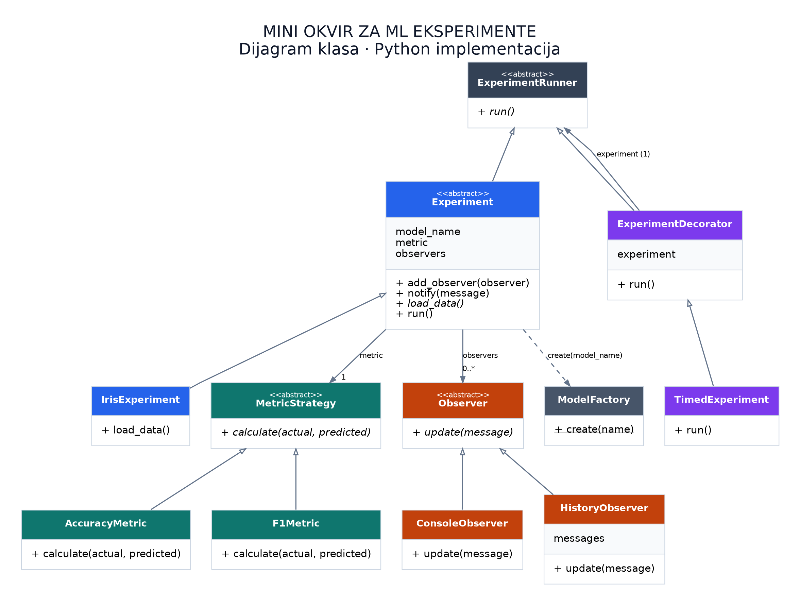
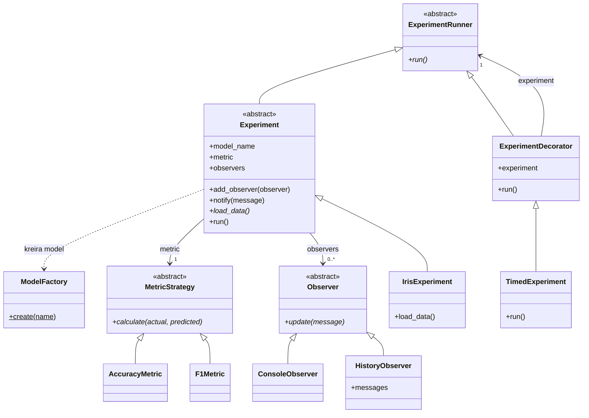

# Mini projekat 2: Mini okvir za ML eksperimente

**Student:** Andrija Gojković  
**Broj indeksa:** FIST 26/016  
**Predmet:** Napredno programiranje

## Opis projekta

Program poredi logističku regresiju, stablo odlučivanja i kNN na Iris skupu podataka. Za svaki model računa accuracy i macro F1, prati tok treninga i mjeri trajanje eksperimenta.

## Pokretanje

Preporučuje se Python 3.12. Komande se izvršavaju u folderu `mini_projekat_2`, sa instaliranim Python-om 3.12:

```powershell
python -m venv .venv
.\.venv\Scripts\python.exe -m pip install -r requirements.txt
.\.venv\Scripts\python.exe main.py
.\.venv\Scripts\python.exe -m pytest -q
```

Iris je uključen u scikit-learn; nije potrebno preuzimati CSV.

## Struktura projekta

| Fajl | Namjena |
| --- | --- |
| `main.py` | Pokretanje šest kombinacija modela i metrika |
| `models.py` | Kreiranje modela |
| `metrics.py` | Accuracy i macro F1 strategije |
| `observers.py` | Ispis i pamćenje događaja |
| `experiments.py` | Tok eksperimenta i dekorator za vrijeme |
| `tests/test_project.py` | Automatski testovi |
| `pytest.ini` | Podešavanja za pytest |
| `requirements.txt` | Zavisnosti projekta |

## Obrasci dizajna

| Obrazac | Primjena |
| --- | --- |
| Factory | `ModelFactory.create()` bira model prema nazivu `linear`, `tree` ili `knn`. Koristi se Simple Factory. |
| Strategy | `AccuracyMetric` i `F1Metric` implementiraju `MetricStrategy`. Izabrana metrika prosljeđuje se eksperimentu. |
| Observer | Eksperiment obavještava posmatrače. `ConsoleObserver` ispisuje događaje, a `HistoryObserver` ih pamti. |
| Template Method | `Experiment.run()` određuje zajednički tok. `IrisExperiment` implementira `load_data()`. |
| Decorator | `TimedExperiment` obavija eksperiment i dodaje vrijeme izvršavanja bez izmjene njegove klase. |

`linear` označava logističku regresiju, odnosno linearni klasifikator. kNN koristi pet susjeda.

## Dijagram klasa



Prazan trougao pokazuje na roditeljsku klasu. Puna strelica označava referencu na drugu klasu, a isprekidana zavisnost. `metric` označava jednu izabranu metriku, `observers` listu od nula ili više posmatrača, a `experiment` jedan obavijeni eksperiment. Apstraktne metode napisane su kurzivom, a statička metoda je podvučena. Prikazani su atributi i metode definisani u klasama, bez konstruktora `__init__`.

[Otvori vektorski dijagram](dijagram_klasa.svg) za uvećanje bez gubitka oštrine.

### Mermaid dijagram

Isti odnosi prikazani su i u Mermaid formatu, prema zahtjevu zadatka.



## Tok eksperimenta

1. Obavještavanje posmatrača o početku.
2. Učitavanje i podjela podataka.
3. Kreiranje modela i početak treninga.
4. Treniranje i obavještavanje o završetku treninga.
5. Predviđanje i izračunavanje metrike.
6. Obavještavanje o završetku eksperimenta i vraćanje rezultata.

Iris sadrži 150 uzoraka, četiri osobine i tri klase. Za trening se koristi 105 uzoraka, a za test 45. Podjela koristi `random_state=42` i `stratify=y`.

Logistička regresija i kNN koriste `StandardScaler` u pipeline-u. Skaler se prilagođava samo trening podacima. Observer prati događaje oko treninga, a ne interne iteracije modela.

## Rezultati

Primjer rezultata iz pripreme projekta (Python 3.12, scikit-learn 1.8.0):

| Model | Accuracy | Macro F1 |
| --- | ---: | ---: |
| Logistička regresija | 0.9111 | 0.9107 |
| Stablo odlučivanja | 0.9333 | 0.9327 |
| kNN | 0.9111 | 0.9095 |

Accuracy je udio tačnih predviđanja. Macro F1 je prosjek F1 vrijednosti svih klasa. Vrijeme obuhvata cijeli eksperiment i zavisi od računara. Primjer koristi jednu podjelu podataka, bez optimizacije hiperparametara.

## Testovi

Svih 14 testnih slučajeva prošlo je i u pripremi i na lokalnom računaru studenta. Testovi obuhvataju kreiranje modela, nepoznat naziv, obje metrike, više posmatrača, ispis, sva tri modela na Iris skupu, zamjenu strategije, dekorator za vrijeme i drugi izvor podataka.

## Upotreba AI alata

ChatGPT je korišćen za generisanje većine Python koda, testova, dokumentacije i dijagrama, kao i za pomoć u podešavanju lokalnog okruženja. Zahtjev je bio izrada jednostavnog ML okvira sa pet obrazaca dizajna, Iris primjerom i najmanje pet pytest testova. Program i testovi pokrenuti su u pripremi projekta, a potom uspješno i na lokalnom računaru studenta.
